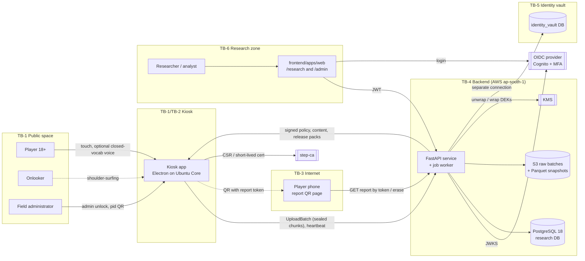
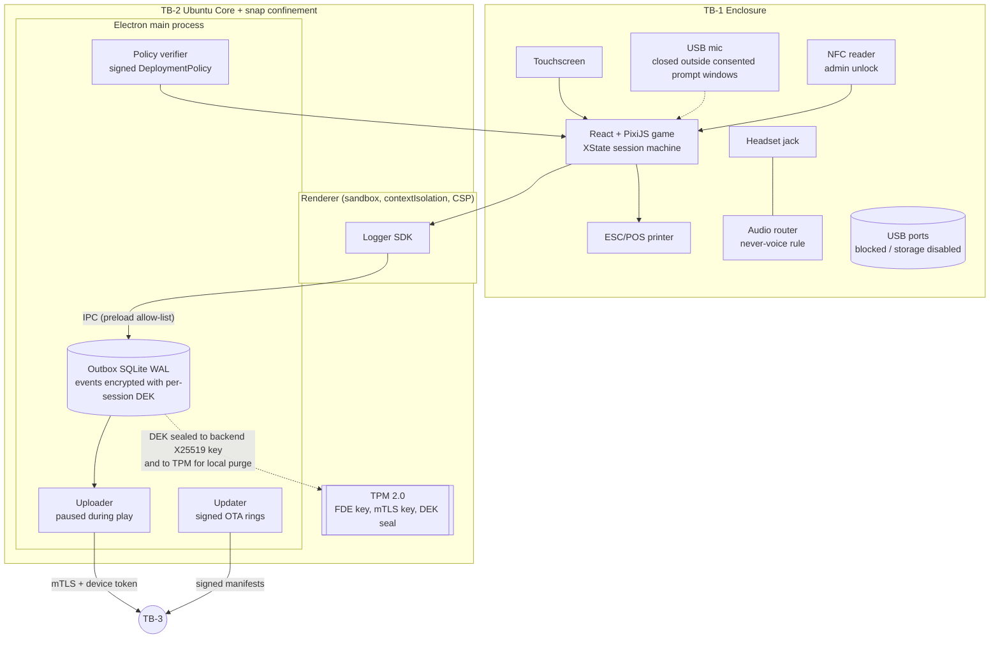
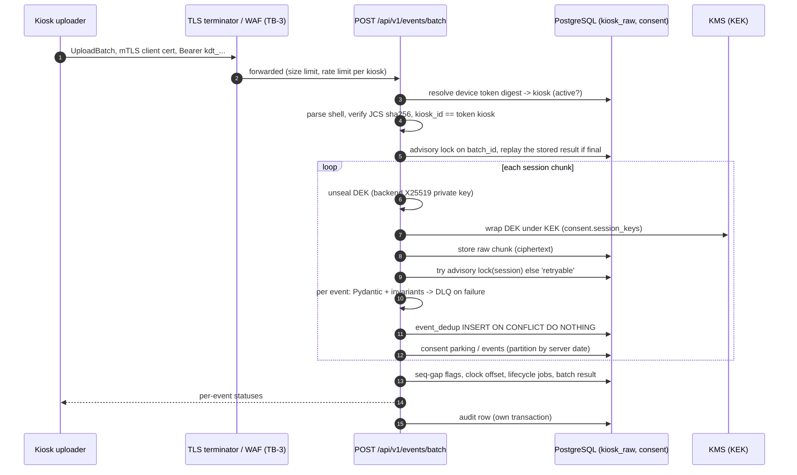
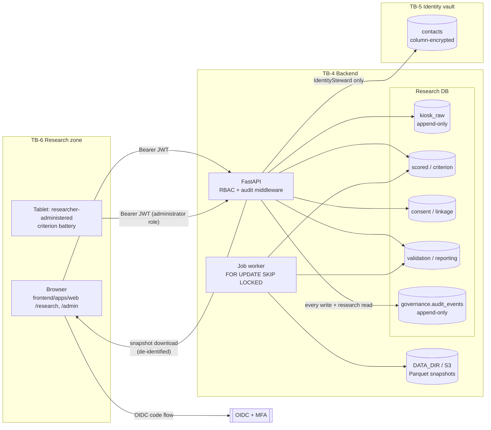
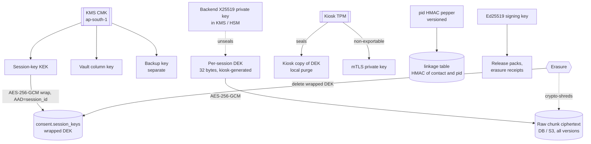
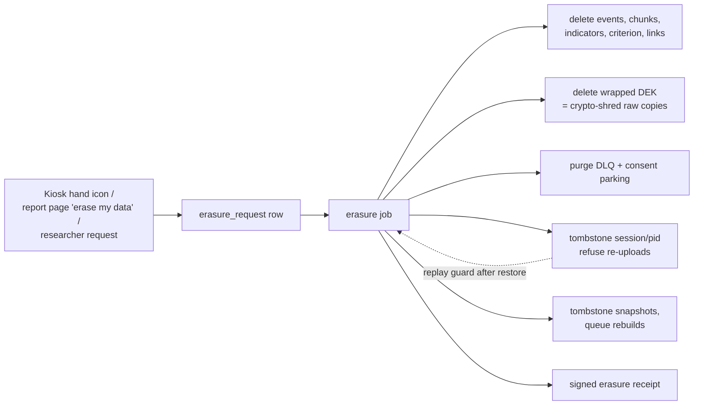

# Data-flow diagrams

These diagrams are the basis for the STRIDE analysis in [threat-model.md](threat-model.md). They show the
**target architecture** from `docs/IMPLEMENTATION_PLAN.md` §2 and `docs/BUILD_DECISIONS.md`. Where the
wave-1 code differs, a note under the diagram says so.

Trust boundaries are drawn as subgraphs with the label `TB-n`. Element IDs (`K1`, `A2`, ...) are used in
the threat tables.

| Boundary | Separates | Main controls at the boundary |
|---|---|---|
| TB-1 Kiosk enclosure | The public (players, onlookers, passers-by) from kiosk hardware | Locked enclosure, no exposed ports, touch-only UI, privacy film, tamper switch (KSK-09, KSK-12) |
| TB-2 Kiosk OS / app | Untrusted local input (touch, USB, network) from the kiosk app and its keys | Ubuntu Core strict confinement, secure boot, TPM-backed FDE, Electron sandbox and CSP (KSK-01, KSK-09) |
| TB-3 Public network | Kiosk and browsers from the backend | TLS 1.3, kiosk mTLS (step-ca), device tokens, WAF/rate limits (PRV-07, PRV-09) |
| TB-4 Backend service zone | API processes from the data stores | Private subnets, per-role DB credentials, KMS key policies (PRV-07, PRV-08) |
| TB-5 Identity vault | Contact data from everything else | Separate DB, separate keys, IdentitySteward-only access (PRV-04) |
| TB-6 Research workstation | Researchers' devices and exports from the platform | OIDC + MFA, RBAC, export justification, de-identified snapshots (PRV-08, VAL-17) |

## L0: system context

## L1: kiosk internals (TB-1, TB-2)

Wave-1 notes: the browser build uses an IndexedDB (Dexie) outbox and sends `none_dev` plaintext chunks;
sealing, SQLite and TPM integration are later features (KSK-07 in Electron). The Electron scaffold already
sets `sandbox`, `contextIsolation`, a strict CSP and a deny-all permission handler
(`frontend/apps/kiosk/electron/main.ts`). The uploader does not attach a device credential yet.

## L1: ingestion (TB-3, TB-4)

Wave-1 notes: the backend X25519 private key and the KEK are environment variables derived from
`DEV_JWT_SECRET` in dev/test and required explicitly in staging/prod (`settings.py`). KMS is the target.
Raw chunks are stored in `kiosk_raw.batch_chunks` (JSONB), not S3. There is no mTLS yet.

## L1: research web app and data platform (TB-4, TB-5, TB-6)

Wave-1 notes: `IDENTITY_DATABASE_URL` falls back to the research `DATABASE_URL` when unset, so in a
default deployment the vault shares the server and credentials with the research DB. Production must set
it (see [scan-findings.md](scan-findings.md), SF-04). Postgres RLS (PRV-08) is not in place; RBAC is
enforced in the API.

## Key hierarchy

Erasing a session deletes its wrapped DEK, which makes every stored copy of its raw chunks unreadable
(ING-08, PRV-06). This only holds while no plaintext copy of the DEK or the events survives elsewhere:
the `kiosk_raw.events` rows (plaintext JSONB) and dead letters are deleted by the erasure job itself, and
backups must expire within the erasure SLA (PRV-05: ≤ 14 days).

## Erasure and withdrawal flow

